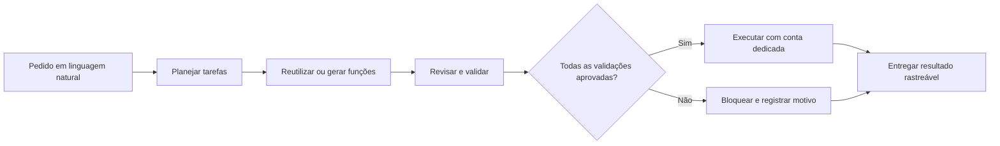
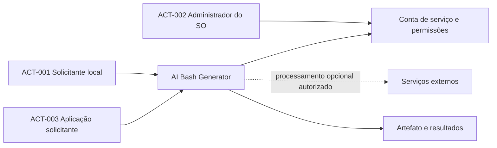

# AI Bash Generator — Charter

  

## Resumo executivo

O AI Bash Generator transforma solicitações em linguagem natural em scripts Bash, busca reutilizar capacidades compatíveis e prevê validação obrigatória antes da liberação do artefato para execução pela conta dedicada do serviço. A operação essencial deve possuir alternativa local offline; processamento externo é opcional e depende de autorização.

## Propósito do projeto

| Campo | Definição documentada |
|---|---|
| Problema / oportunidade | A automação de operações Linux exige conhecimentos especializados, revisão dos comandos e retrabalho quando solicitações semelhantes se repetem. |
| Propósito | Gerar e compor scripts Bash a partir de linguagem natural, validar sua correção e segurança e, após aprovação de todas as verificações obrigatórias, permitir execução automática sob permissões controladas. |
| Beneficiários / stakeholders | Solicitante local, aplicação cliente e administrador do sistema operacional que controla a identidade e as permissões do serviço. |
| Valor esperado | Redução do esforço de automação repetitiva, reutilização de funções, retorno rastreável e bloqueio seguro de operações não aprovadas. |

## Visão geral do funcionamento

O diagrama resume intenções funcionais; os contratos de transporte, algoritmos e implantação não são definidos aqui.

## Contexto e participantes

Os diagramas não autorizam novos canais externos nem ampliam privilégios. Dependências externas requerem Discovery.

## Tecnologias adotadas ou previstas no projeto existente

Go, Debian/Linux, Bash, Unix Domain Sockets, Protocol Buffers e inferência por `llama.cpp` são mencionados no README/código existentes. Sua descrição técnica pertence às etapas posteriores, e essa evidência não os transforma automaticamente em restrições de Charter.

## Índice navegável

- [PCH-001 — Contexto e atores](project-context/PCH-001-geracao-e-execucao-de-scripts-bash-com-permissoes-controladas.md)
- [Objetivos OBJ](objectives/README.md)
- [Não objetivos NOBJ](non-objectives/README.md)
- [Restrições e premissas CON/ASM](conditions/README.md)
- [Questões abertas OPEN](open-questions/README.md)
- [Discovery e estudos de viabilidade](discovery/README.md)
- [ProjectCharter/1.0 — regra normativa externa](https://github.com/ahhvahh/doc-arquitetura/tree/main/ProjectCharter/1.0)

## Situação da baseline

**BLOCKED — Charter → Scope.** OPEN-001 mantém casos e metas de teste pendentes; OPEN-020 contém condições de liberação ainda indefinidas. OPEN-021 e OPEN-022 dependem de conclusão sobre interrupção e liberação. Também requer reconciliação a divergência entre o README técnico anterior e o Charter sobre a execução automática e o mínimo de CPUs.

A origem documental está preservada no [backup histórico](../backup/README.md). A análise não promove status a `refined` nem comprova implementação.
